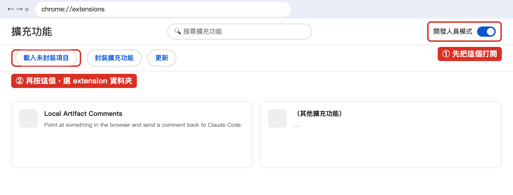

# 安裝教學（5 分鐘）

在瀏覽器裡對任何網頁「指著某個地方留言」，留言連同截圖直接送進 Claude Code。
只支援 macOS + Chrome。

裝好一次之後，**外掛和 Chrome 擴充功能都會自己更新**，不用再重裝。

> 以前用 zip 裝過的人：請先看最下面的「從 zip 版本換過來」。

## 0. 事前準備

- 已經在用 **Claude Code**（終端機輸入 `claude` 會啟動）。
- 安裝 **Node.js 20 以上**：到 <https://nodejs.org> 下載「LTS」版，一路下一步。
  裝好後在終端機輸入 `node -v`，看到 `v20` 或更高就可以。
- **git**：終端機輸入 `git --version`。如果跳出「需要安裝開發者工具」的視窗，按「安裝」等它裝完。
- **Google Chrome**。

## 1. 裝進 Claude Code

打開終端機，貼上這兩行：

```bash
claude plugin marketplace add yi-chen-maxnion/local-artifact
claude plugin install local-artifact@local-artifact
```

## 2. 打開自動更新（很重要）

Claude Code 對這種外掛**預設不會自動更新**，要自己打開一次：

1. 啟動 Claude Code（`claude`），輸入 `/plugin`
2. 選 **Marketplaces** → **local-artifact** → **Enable auto-update**

打開之後，有新版本時 Claude Code 會自己下載，**下次啟動 Claude Code 時**就是新版。

## 3. 裝 Chrome 擴充功能（一定要，只要做一次）

1. 在你的專案資料夾裡啟動 Claude Code（`claude`），輸入：

   ```
   /connect
   ```

   第一次會看到 `extension  NOT SEEN`，後面接著一個資料夾路徑：

   ```
   ~/.config/local-artifact/extension
   ```

   並說 `that folder is on the clipboard`——路徑**已經複製好了**，下面會用到。

2. Chrome 網址列輸入 `chrome://extensions`
3. 右上角打開 **開發人員模式**，而且**之後都不要關掉**（關掉的話這個擴充功能會被停用）。
4. 按 **載入未封裝項目**，在跳出來的選資料夾視窗裡：
   按 **Cmd+Shift+G** → 按 **Cmd+V** 貼上路徑 → 按 **Return** → 按 **選擇**。
   （這個資料夾在隱藏目錄裡，直接點是找不到的，所以要用貼的。）



Chrome 會說這個擴充功能「可以讀取所有網站」——它需要這個權限才能在任何網頁上放留言按鈕和截圖。

5. 回到 Claude Code，再輸入一次 `/connect`。看到這兩行就是成功：

   ```
   extension  seen 5s ago
     monitor listening
   ```

## 4. 開始用

1. 在 Chrome 打開任何網頁（本機開發站、正式站都可以）。
   畫面**右邊邊緣**有一個半藏著的 💬 按鈕，滑鼠靠近會滑出來。
2. 按下 💬，點網頁上的任何東西，打字，按 **Send**。
   Claude Code 那邊會立刻收到留言、位置和截圖。

之後要換另一個專案，就到那個專案的 Claude Code 裡再打一次 `/connect`；留言會送到**最後一個**打 `/connect` 的 session。

## 5. 之後的更新：什麼都不用做

- **外掛**：有新版本時 Claude Code 會自己下載，下次啟動 Claude Code 就是新版。
- **Chrome 擴充功能**：外掛更新後，擴充功能會在你開一兩個網頁之內**自己更新**，不用去 `chrome://extensions`。
  如果你正在寫一則還沒送出的留言，它會等你送出後才更新（這段時間工具列圖示上會顯示 `UP`）。

`/connect` 有時會多說一句，意思如下：

| 看到什麼 | 意思 |
|---|---|
| `extension 0.2.0, plugin 0.2.1 - it updates itself within a page load or two` | 正在更新中，正常。開一兩個網頁就好 |
| `bridge 0.2.1 is running from a newer copy of the plugin - restart this session to update it` | 別的 Claude Code 視窗已經是新版了。這個視窗照樣能用，有空時把它關掉重開 |

## 6.（選用）把留言貼到 Slack

1. 點 Chrome 右上角這個擴充功能的圖示，在 **Slack** 那一列按 **連線**。
2. 瀏覽器會跳出 Slack 授權頁，按允許。回到選單會看到你的名字和 workspace。

之後留言面板上多一個 **Slack** 按鈕，可以把留言（含截圖）用你自己的名義貼到頻道或私訊。
要斷開就回同一個選單按 **中斷連線**。

## 從 zip 版本換過來

以前用 zip 裝的版本**不會自動更新**，要手動換一次，之後就不用再換了。

1. 在終端機移除舊的：

   ```bash
   claude plugin marketplace remove local-artifact
   ```

2. 照上面的 **第 1、2、3 步** 裝新的（外掛、自動更新、Chrome 擴充功能）。
3. 在 `chrome://extensions` 找到**舊的** Local Artifact Comments——它的卡片上寫的路徑是你以前解壓縮的資料夾（例如 `~/local-artifact/extension`）——按 **移除**。
   **只留下**從 `~/.config/local-artifact/extension` 載入的那一個。
4. 把開著的網頁都**重新整理一次**（舊版留下的按鈕要重新整理才會消失）。
5. 把所有開著的 Claude Code 視窗**關掉重開**。
6. 以前解壓縮的那個資料夾之後就可以刪掉了。

注意：新的擴充功能在 Chrome 眼中是另一個擴充功能，所以你以前在工具列選單裡**關掉的網站**，要再關一次。

如果 `/connect` 說 `an older copy of the extension is also loaded`，就是第 3 步的舊擴充功能還沒移除。

## 出問題時看這裡

| 看到什麼 | 怎麼辦 |
|---|---|
| `/connect` 印出 `extension  NOT SEEN` | 第 3 步沒做，或擴充功能被停用（例如開發人員模式被關掉了）。到 `chrome://extensions` 確認開發人員模式和擴充功能都開著，再打一次 `/connect` |
| `an old copy that cannot update itself` 或 `an older copy of the extension is also loaded` | 舊的 zip 版擴充功能還在。照「從 zip 版本換過來」的第 3、4 步做 |
| 網頁上沒有 💬 按鈕 | 先在 Claude Code 打 `/connect`，再**重新整理**那個網頁 |
| `monitor NOT ATTACHED` | 關掉 Claude Code 重開一次，再 `/connect` |
| 留言送出但截圖說 `not the visible tab` | 送出時那個分頁被切到背景了；回到那個分頁再送一次 |

更多細節在 `README.md`。
