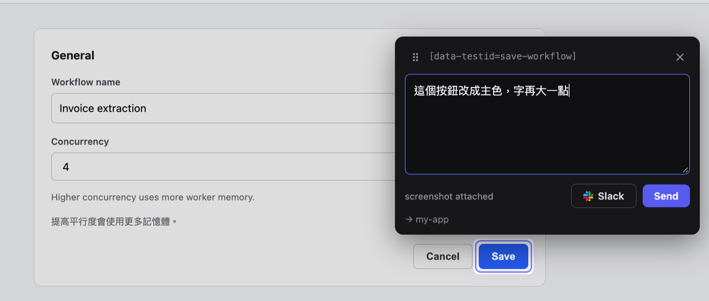
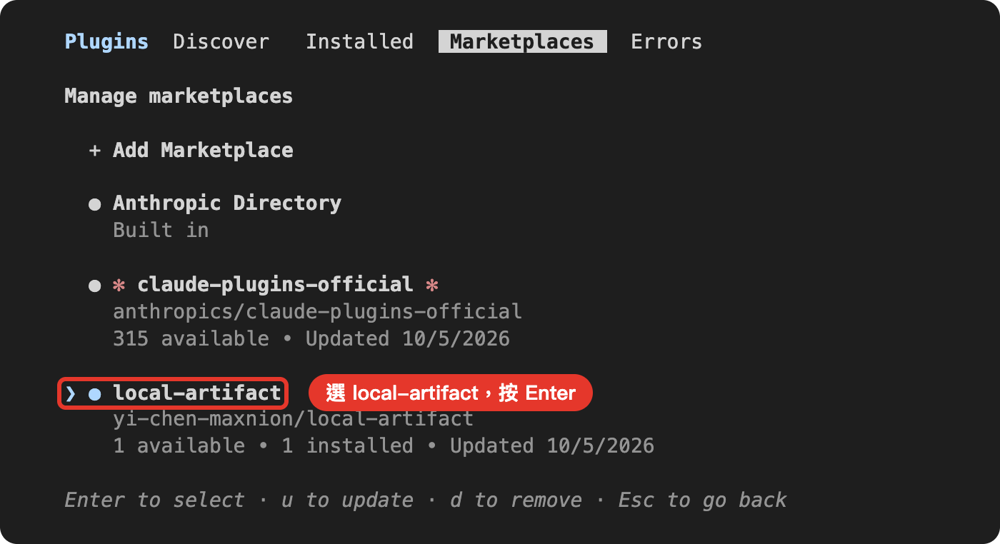
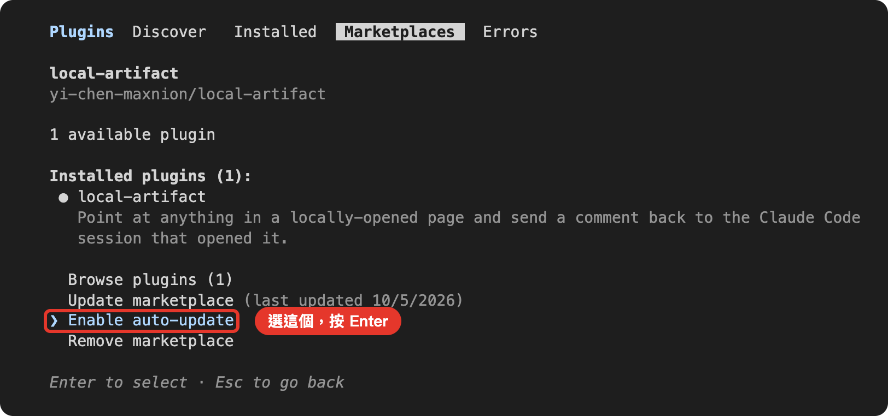
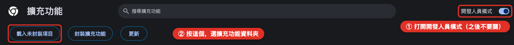
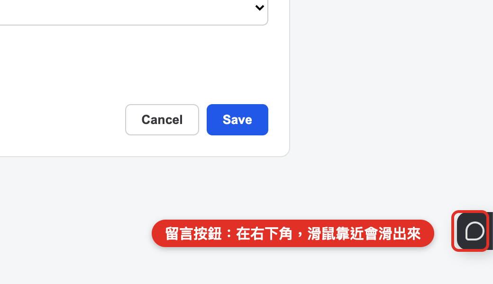
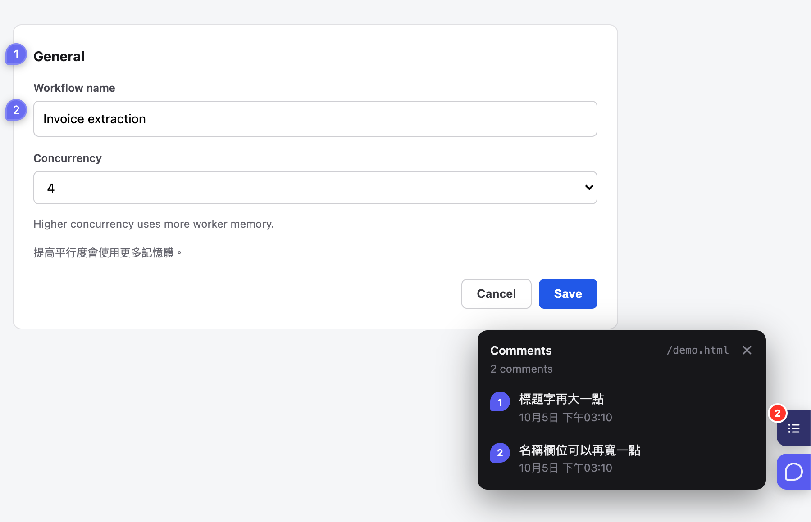
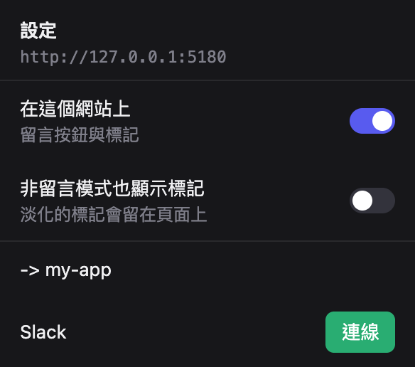

# Local Artifact Comments

在 Chrome 裡**指著網頁上的東西留言**，留言、它指的位置和截圖會直接送進 Claude Code，Claude 收到就動手改。
本機開發站、正式站、Claude 幫你做的報告都能用。



只支援 **macOS + Google Chrome**。

- [安裝](#安裝)（只要做一次，約 5 分鐘）
- [使用](#使用)
- [更新](#更新)
- [從 zip 版換過來](#從-zip-版換過來)
- [出問題時](#出問題時)

## 安裝

需要先有：

- **Claude Code**
- **Node.js 20 以上**：到 <https://nodejs.org> 下載 LTS 版。終端機輸入 `node -v`，看到 `v20` 以上就可以。
- **git**：終端機輸入 `git --version`。如果跳出「安裝開發者工具」的視窗，按「安裝」。
- **Google Chrome**

### 步驟 1：安裝外掛

在終端機貼上這兩行：

```bash
claude plugin marketplace add yi-chen-maxnion/local-artifact
claude plugin install local-artifact@local-artifact
```

### 步驟 2：打開自動更新

這個外掛**預設不會自動更新**，要自己打開一次：

1. 啟動 Claude Code（終端機輸入 `claude`），輸入 `/plugin` 按 Enter。
2. 按 **Tab** 兩次切到 **Marketplaces** 分頁，用 **↓** 選到 **local-artifact**，按 Enter。

   

3. 用 **↓** 選到 **Enable auto-update**，按 Enter。看到 `Auto-update enabled.` 就好了，按 Esc 離開。

   

步驟 1 之前就開著的 Claude Code 視窗還沒有這個外掛，關掉重開就好。

### 步驟 3：安裝 Chrome 擴充功能

1. 在你的專案資料夾啟動 Claude Code，輸入 `/connect`。
   第一次它會說擴充功能還沒裝（`extension  NOT SEEN`），並且把要用的資料夾路徑**複製好了**。
2. Chrome 網址列輸入 `chrome://extensions`。
3. ① 打開右上角的**開發人員模式**，② 按**載入未封裝項目**。

   

   開發人員模式之後**不要關**，關掉的話擴充功能會被停用。

4. 在跳出來的選資料夾視窗，依序按 **Cmd+Shift+G** → **Cmd+V** → **Return** → **選擇**。
   （資料夾在隱藏目錄裡，用點的找不到，所以用貼的。）
5. 回 Claude Code 再輸入一次 `/connect`。看到 `extension  seen …` 就完成了。

擴充功能要在任何網頁放留言按鈕和截圖，所以需要「所有網站」的權限。
只有在 Claude Code 連線時，網頁上才會出現按鈕。

## 使用

1. 在要收留言的 Claude Code 輸入 `/connect`。
2. 在 Chrome 打開網頁，**右下角**有一個留言按鈕（對話框圖示），滑鼠靠近會滑出來。

   

3. 按留言按鈕 → 點網頁上的東西 → 打字 → 按 **Send**（或 Cmd+Enter）。

Claude Code 會立刻收到留言、位置和截圖，然後開始改。
送出的留言會在網頁上留下編號圖釘，點圖釘可以看回內容。



| 想要… | 怎麼做 |
|---|---|
| 指一個按鈕、圖片或區塊 | 點它 |
| 引用一段文字 | 用滑鼠拖過那段字 |
| 圈一塊範圍 | 在空白處拖一個框（按住 Option 可以框文字） |
| 看這頁所有留言 | 留言模式下，留言按鈕上方的紅色數字按鈕 |
| 離開留言模式 | 按 Esc（面板開著時按兩次），或按右鍵 |

其他常用的：

- **同時開好幾個專案**：留言會送到**最後一個**輸入 `/connect` 的 Claude Code。
- **暫時不想收留言**：輸入 `/disconnect`。要再收就 `/connect`。
- **某個網站不要出現按鈕**：點 Chrome 工具列上這個擴充功能的圖示，關掉**在這個網站上**。
- **Claude 做的報告、圖表**：Claude 會自己在 Chrome 打開給你看，一樣可以直接留言。
- **貼到 Slack**（選用）：工具列圖示 → Slack → **連線**。之後留言面板多一個 **Slack** 按鈕，
  用你自己的名義把留言貼到頻道或私訊。貼到 Slack 的那則**不會**送給 Claude。



## 更新

打開自動更新之後，**什麼都不用做**：

- **外掛**：有新版時，Claude Code 會在你開始用之後幾分鐘內在背景下載，**下次啟動 Claude Code** 就是新版。
- **Chrome 擴充功能**：外掛更新後，擴充功能會在你開一兩個網頁之內自己更新，不用去 `chrome://extensions`。
  如果你正在寫留言，它會等你送出（這時工具列圖示顯示 `UP`）。

想馬上更新：`/plugin` → **Marketplaces** → **local-artifact** → **Update marketplace**，然後重開 Claude Code。

`/connect` 有時會多說一句：

| 看到 | 意思 |
|---|---|
| `extension 0.2.0, plugin 0.2.1 - it updates itself within a page load or two` | 擴充功能正在更新，開一兩個網頁就好 |
| `bridge 0.2.1 is running from a newer copy of the plugin` | 別的 Claude Code 視窗已經是新版。這個視窗照樣能用，有空重開就好 |

## 從 zip 版換過來

以前用 zip 裝的版本不會自動更新，要手動換一次：

1. 終端機輸入 `claude plugin marketplace remove local-artifact`，移除舊的外掛。
2. 照上面[安裝](#安裝)的步驟 1～3 裝新的。
3. 在 `chrome://extensions` 移除**舊的** Local Artifact Comments（卡片上的路徑是你以前解壓縮的資料夾），
   只留從 `~/.config/local-artifact/extension` 載入的那一個。
4. 開著的網頁重新整理一次，Claude Code 視窗全部關掉重開。

以前在工具列選單**關掉的網站**要再關一次：新的擴充功能在 Chrome 眼中是另一個。

## 出問題時

| 看到什麼 | 怎麼辦 |
|---|---|
| `/plugin` 裡沒有 **Enable auto-update** | 你的環境關掉了 Claude Code 的自動更新（設了 `DISABLE_AUTOUPDATER`、`DISABLE_UPDATES` 或 `CLAUDE_CODE_DISABLE_NONESSENTIAL_TRAFFIC`）。在 `~/.zshrc` 加一行 `export FORCE_AUTOUPDATE_PLUGINS=1`，重開終端機再做一次步驟 2 |
| `/connect` 說 `extension  NOT SEEN` | 步驟 3 還沒做完，或擴充功能被停用（例如開發人員模式被關掉）。到 `chrome://extensions` 確認兩個都開著，再 `/connect` |
| `an older copy of the extension is also loaded` 或 `an old copy that cannot update itself` | 舊的 zip 版擴充功能還在，照[從 zip 版換過來](#從-zip-版換過來)的第 3、4 步 |
| 網頁上沒有留言按鈕 | 先在 Claude Code 輸入 `/connect`，再重新整理網頁。工具列圖示顯示 `off` 的話，是這個網站被關掉了 |
| `monitor NOT ATTACHED` | 關掉 Claude Code 重開，再 `/connect` |
| 面板說 `The bridge is not answering` | 在 Claude Code 再輸入一次 `/connect`，然後再按 Send，留言還在框裡 |
| 截圖說 `not the visible tab` | 送出時那個分頁不在最前面。回到那個分頁再送一次 |

還是不行，直接問 Claude「留言怎麼沒送到？」，它會自己檢查。

## 給開發者

- [docs/REFERENCE.md](docs/REFERENCE.md)：每個部分怎麼運作、安全性、Slack app 設定、開發和發布新版（`npm run release`）。
- [docs/DESIGN.md](docs/DESIGN.md)：為什麼這樣設計，試過哪些做法。
